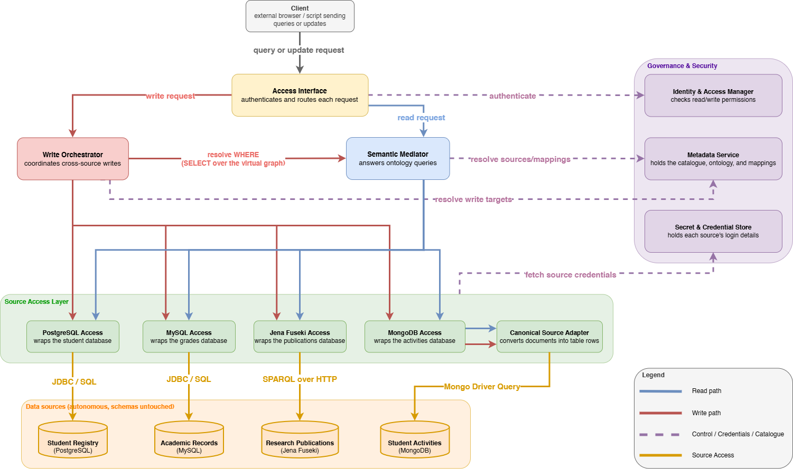

# Virtual Data-Centric System prototype

This repository contains the limited-scope prototype for the University of Twente Master's thesis *Designing and Evaluating a Reference Architecture for Virtual Data-Centric Systems*, by Victor-Adrian Alecu. It instantiates the reference architecture proposed in the thesis to evaluate how its principles can guide the development of a data-centric system. The prototype demonstrates how applications can query and update autonomous, heterogeneous data sources through a shared semantic interface.

The use case is a synthetic university whose information is managed by several departments. The registrar keeps student and enrollment records, academic staff maintain courses and grades, student organisations record clubs and projects, and a research repository holds publications. Each source has its own structure and responsibilities, but the information is related: the same student can be enrolled in a course, receive grades, belong to a club, and co-author a publication.

A university therefore provides a familiar setting for exploring integration across independently managed systems. Questions such as which students have published research and which clubs they belong to require information from several sources. Final course grades also appear in two systems, allowing the prototype to demonstrate how one update can reach multiple owners of the same information. Synthetic data makes these scenarios repeatable without relying on real student records.

The prototype supports SPARQL reads, canonical JSON writes, and a subset of SPARQL Update for architectural experiments and local demonstrations.

## How it works



Applications interact with the **access interface**, using the shared university vocabulary rather than each data source's native structure. The interface checks the caller's identity and permissions through the **Identity and Access Manager**, then sends the request along the read or write path.

For a **read**, the **semantic mediator** consults the metadata service to identify the relevant sources and mappings. Those mappings connect each source's representation to the common ontology. The mediator retrieves the required information and combines it into a single answer, such as student names from the registry joined to publications and club memberships from other sources.

For a **write**, the **write orchestrator** identifies the source services responsible for the requested entity and asks them to apply the change. Each source service translates the request into operations understood by its data source. A SPARQL update with a `WHERE` clause first uses the mediator to find the matching data. Where an entity has multiple write owners, such as FinalGrade, the orchestrator coordinates the changes across them. If a later operation fails, it attempts to restore earlier changes using their saved state.

The **source access layer** connects these shared operations to the individual data sources. Each source has a dedicated **source access service** that handles its connection details and source-specific operations. This keeps knowledge of each source's access mechanisms separate from the shared query and write logic, so sources with different technologies can participate in the same system. MongoDB also has a **canonical source adapter** alongside its source access service. The query engine used for its ontology mappings expects relational data and cannot query MongoDB documents directly. The adapter therefore projects the documents into relational tables that the mediator can query, while MongoDB retains the original document representation. PostgreSQL and MySQL already provide relational data, and the RDF source supports graph queries, so they do not need this additional conversion.

The **metadata service** holds the source catalogue, ontology, and mappings, while the **secret and credential store** supplies source credentials to the source services. Together, these supporting services keep source descriptions, access decisions, and credentials separate from application queries.

The baseline on `main` has four sources:

| Source | Storage | Data |
| --- | --- | --- |
| Student Registry | PostgreSQL | Students, programmes, enrollments, final grades |
| Academic Records | MySQL | Courses, assessments, grades, final grades |
| Student Activities | MongoDB | Clubs and projects |
| Research Publications | Fuseki/RDF | Publications and authorship |

## Requirements

- Windows PowerShell
- JDK 21, with `JAVA_HOME` configured
- Maven 3.9 and Docker available on `PATH`
- Docker Desktop running with Linux containers and Docker Compose

Run the commands below from the repository root on `main`.

## Start

```powershell
.\scripts\run-all.ps1
```

The script uses the configured Java installation, starts and initializes the four database containers, builds the project, and launches the Java services.

Open [the access interface](http://localhost:8080). Use `teacher-token` for full demo read/write access, or `alice-token` for restricted read-only access. `dev-token` also has full access.

## Tests

The project has three complementary ways of testing:

- **Manual tests** walk through scenarios in the browser interface, with direct source checks where needed. They make the behaviour visible to a human tester: what to submit, what to expect, and how to restore the starting state. The manual guide also links to the separate F4 and F5 extension demonstrations.
- **Automated script-based tests** run an end-to-end check of the system through a fixed sequence of representative scenarios. The tests include reads across sources, writes, access control, metadata, provenance, and compensation after failed writes. They use the supplied seed data and report PASS/FAIL results for each check.
- **Java tests** focus on FinalGrade-related behaviour along the write path, where updating information held by multiple sources introduces additional correctness concerns. They check request validation, rejection before execution, routing to all registered owners, and restoration of the affected enrollment during compensation.

For the manual scenarios, follow [test.md](test.md).

With the environment running, run the automated script-based tests:

```powershell
.\scripts\run-tests.ps1
```

Run the Java tests:

```powershell
mvn test
```

## Extension branches

This prototype also contains two extension branches. Each contains a copy of the baseline on `main` with its own add-on, without the changes introduced by the other extension.

- **`f4-loans`** adds a fifth, read-only Library Loans source. See [the F4 branch guide](scripts/README-f4-loans.md).
- **`f5-nationality`** adds a student nationality column in PostgreSQL and exposes it through the ontology. See [the F5 branch guide](scripts/README-f5-nationality.md).

Start the baseline first, then use the dedicated scripts to run and roll back each demonstration. The scripts require a clean working tree.

## Stop

```powershell
.\scripts\stop-all.ps1 -StopDb
```

This stops the Java services and database containers. PostgreSQL, MySQL, and MongoDB retain their data; Fuseki reloads its seed data on restart.

## Code layout

- `ontology/` and `mappings/`: shared vocabulary and source mappings.
- `metadata-service/`: source catalogue and semantic artefacts.
- `access-interface/`, `iam-service/`, and `secret-store-service/`: API and UI, access policies, and source credentials.
- `semantic-mediator/`: query routing and federation.
- `write-orchestrator/` and `write-orchestrator-service/`: write planning, execution, and compensation.
- `source-access/`: source services and adapters.
- `infra/` and `scripts/`: seed data and setup/test scripts.
